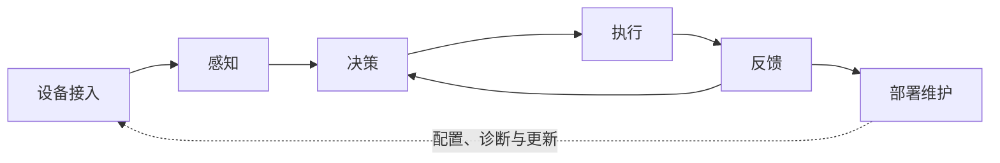

# 完整机器人二次开发框架

在厂商提供的硬件、固件和接口基础上，打通 **设备接入 → 感知 → 决策 → 执行 → 反馈 → 部署维护**。本框架提供方向、接口边界和最小示例，具体算法与场景由开发者自行适配。

## 六个环节与闭环

箭头表示主要信息关系。设备状态反馈既是执行前置条件，也用于执行中的闭环判断；部署维护、测试和仿真贯穿整个过程。

| 环节 | 能力入口 | 已有实践章节 | 阶段成果 |
| --- | --- | --- | --- |
| A 设备接入 | [设备接入](framework/01-access.md) | 00、01、02、06 | 设备能力清单、环境报告与通信契约 |
| B 感知 | [感知](framework/02-perception.md) | 08、09 | 带来源、时间与适用范围的观测结果 |
| C 决策 | [决策](framework/03-decision.md) | 04、10 | 可拒绝、可取消、可追踪的任务计划 |
| D 执行 | [执行](framework/04-execution.md) | 05、11 | 受约束的执行接口与结果语义 |
| E 反馈 | [反馈](framework/05-feedback.md) | 03、07、12 | 可解释的状态、故障与操作反馈 |
| F 部署维护 | [部署维护](framework/06-operations.md) | 13 | 可复现、可诊断、可回退的项目交付 |

14篇教程是已有的最小实践集合，六个环节是完整能力地图。章节主归属用于导航，跨环节依赖通过文内链接说明；一个章节不能替代该环节的所有能力。

## 能力覆盖与实现边界

| 方向 | 所属环节 | 本仓库提供什么 | 使用者扩展什么 |
| --- | --- | --- | --- |
| 硬件认知、开发环境、SDK与通信 | 设备接入 | 系统图、环境检查、网络说明、回环UDP | 厂商SDK适配、驱动、外设和目标环境 |
| 机器人模型、坐标与标定 | 感知 / 执行 | 输入输出和单位、坐标要求 | 模型、标定、正逆运动学 |
| 音频与语音识别 | 感知 | WAV实验、可选文件ASR | 麦克风、流式识别、语音服务 |
| 视觉、融合、建图与定位 | 感知 | 能力说明及视觉参考源码 | 标定、检测、SLAM、状态估计与评估 |
| 任务决策与行为编排 | 决策 | 精确白名单、生命周期设计 | 技能系统、状态机/行为树、任务规划 |
| 导航与多机协作 | 感知 / 决策 / 执行 / 反馈 | 通信、目标过滤与掉线示例 | 定位、路径规划、跟踪、避障与调度 |
| 运动、手臂与灵巧手 | 执行 | 动作数据校验、参考源码、接口边界 | 设备运动适配、轨迹、抓取、力/触觉闭环 |
| 播放与人机交互 | 执行 / 反馈 | 广播契约、Tkinter示例、App参考 | 音频设备、Web/App、遥操作和权限 |
| 状态、故障与监控 | 反馈 | 模拟/只读状态示例、诊断与报告 | 完整遥测、状态有效期、告警平台 |
| 仿真、数据与学习算法 | 贯穿六环节 | 教学控制仿真、数据格式与验证方向 | 机器人仿真、采集/回放、模仿/强化学习、模型评估 |
| 测试、部署与维护 | 部署维护 | 电脑回归、预检、交付模板和部署参考 | 设备验收、服务管理、监控、升级与回滚 |

有参考源码不等于已提供可复现的完整能力；六环节结构完成不等于整机系统完成。实现证据从[验证资料](README.md)进入。

## 所有内容使用同一套模板

各环节的子能力表说明先做什么；需要展开设计时，从[八个扩展专题](topics/README.md)选择接口、感知、导航、任务、操作、仿真数据、运行维护或场景拆解。专题中的最小任务可先在纸面、固定数据或模拟条件下完成，具体算法与硬件适配由使用者实现。

| 栏目 | 回答的问题 |
| --- | --- |
| 能力目标 | 解决什么问题，职责是什么？ |
| 前置条件 | 需要哪些知识、环境、接口和资源？ |
| 输入输出与接口 | 接收什么、产生什么、何时失败？ |
| 最小示例 | 用最少条件怎样观察这项能力？ |
| 可修改与扩展点 | 哪些可替换，哪些由使用者实现？ |
| 验证方法 | 用什么证据判断正确、失败和适用范围？ |

模板见[编写约定](lesson-template.md)。示例保留可运行路径；扩展部分给接口与验收方向，不预设所有使用者采用同一算法。

## 如何开始

- 零基础：先做[准备单元](course-syllabus.md)。
- 只有电脑：按[电脑路线](learning-path.md)完成最小闭环，模型实验按条件加入。
- 有设备：先连接和只读状态，再验证单命令及结束行为，逐步增加能力。
- 已有项目：从所需环节进入，查看接口、参考代码和待实现项。

安全、控制权、单位与坐标、时间与数据有效性、日志、权限及资源许可贯穿六环节。ROS 2、特定模型与硬件按需选择；调用厂商运动能力和自行开发运动控制算法分别作为不同深度的路线。
